<p align="center">
  <picture>
    <source media="(prefers-color-scheme: dark)" srcset="design/logo/pluto-monograma-horizontal-escuro.svg">
    
  </picture>
</p>

<p align="center">
  <strong>Finanças pessoais com dados reais do seu banco, planejamento automático e um agente que explica cada número.</strong>
</p>

<p align="center">
  <a href="https://github.com/PauloVictoSantos/Pluto/actions/workflows/ci.yml"></a>
  
  
  
  
  
</p>

<p align="center">
  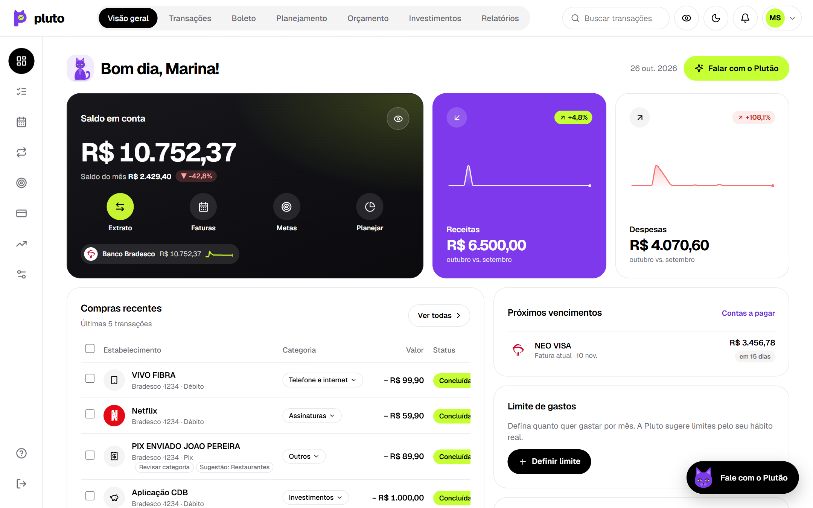
</p>

---

O **Pluto** é um app web de finanças pessoais, responsivo do celular ao desktop. Ele importa contas, cartões, faturas e investimentos pelo **Open Finance** (Pluggy), organiza os gastos sozinho e monta o plano do mês. Um agente financeiro, o **Plutão**, conversa sobre tudo isso. Os cálculos ficam num motor financeiro testado; a IA só conversa e explica, e não inventa valores.

## Sumário

- [Funcionalidades](#funcionalidades)
- [Telas](#telas)
- [Arquitetura](#arquitetura)
- [Stack](#stack)
- [Segurança e privacidade](#segurança-e-privacidade)
- [Como rodar](#como-rodar)
- [Comandos](#comandos)
- [Qualidade](#qualidade)
- [Deploy e operação](#deploy-e-operação)

## Funcionalidades

**Visão do dinheiro**
- Saldo, receitas, despesas e investido, com variação contra o mês anterior e minigráficos de 30 dias.
- Contas e cartões importados do banco pelo Open Finance, com faturas, parcelas e vencimentos.
- Projeção do saldo no fim do mês e saúde financeira de 0 a 100.

**Gastos organizados**
- Forma de pagamento (Pix, débito, crédito, boleto) separada da categoria: Pix não é categoria.
- Classificação em camadas: suas regras, depois palavras do texto e, por último, IA. A IA só entra para pagamentos a empresas e com o seu consentimento.
- **Revisar**: o que fica com menos de 70% de certeza você confirma com um toque, e a escolha vira regra.
- Gastos fixos detectados no extrato: o mesmo estabelecimento, em 3 meses, com valor e dia parecidos.

**Planejamento**
- Todo dia 1º, às 6h, o Pluto monta o plano do mês: compromissos, sobra, limites por categoria e um destino para cada real (reserva, dívidas caras, metas, investimento).
- Cada decisão vem com o "por quê", e você pode ajustar qualquer valor.
- Alertas quando uma categoria chega a 80% e a 100% do limite, e sugestão de destino quando entra dinheiro extra.

**Plutão, o agente financeiro**
- Recebe a cada mensagem um resumo das suas finanças (renda, dívidas, metas e gastos por categoria) e consulta os dados por ferramentas.
- Faz perguntas com opções, simula compras ("Posso comprar?") e cria metas e gastos fixos, sempre com confirmação.
- Proteções: não grava nada sem "sim", não repete número que não veio dos seus dados e bloqueia tentativas de manipular as instruções dele.

**Metas, investimentos e cobranças**
- Metas com diagnóstico, cenários e prioridade; um único plano de dívidas para o chat, as metas e o planejamento.
- Caixinhas e investimentos com rendimento projetado para 1 mês, 1 ano e 5 anos, ligados às metas.
- Boletos pelo Stripe, parcelados, com contatos salvos e envio por e-mail.
- Scanner de cupom fiscal: lê o QR Code da NFC-e direto na SEFAZ e risca da lista de compras o que foi comprado.

## Telas

<table>
  <tr>
    <td width="50%">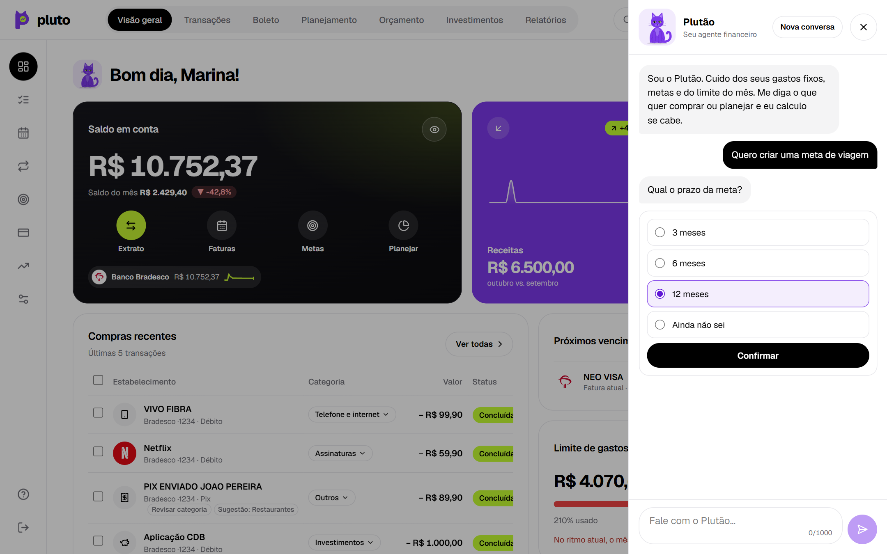<br><sub><b>Plutão</b> · pergunta com opções e confirmação</sub></td>
    <td width="50%">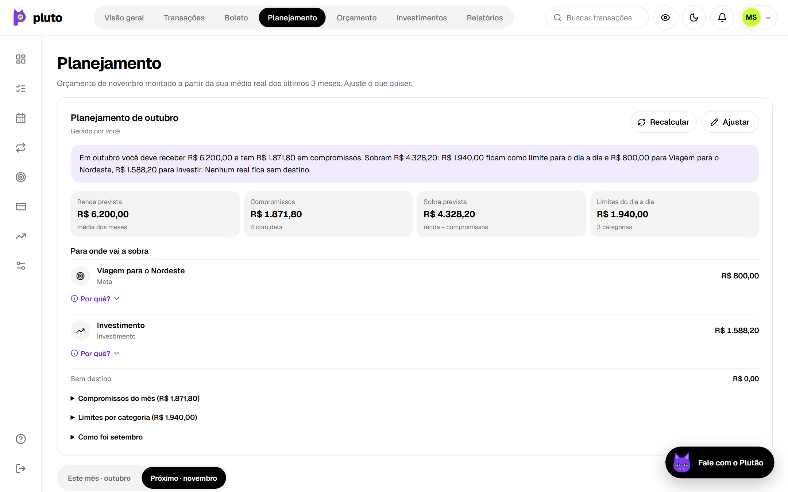<br><sub><b>Planejamento</b> · cada real com destino</sub></td>
  </tr>
  <tr>
    <td>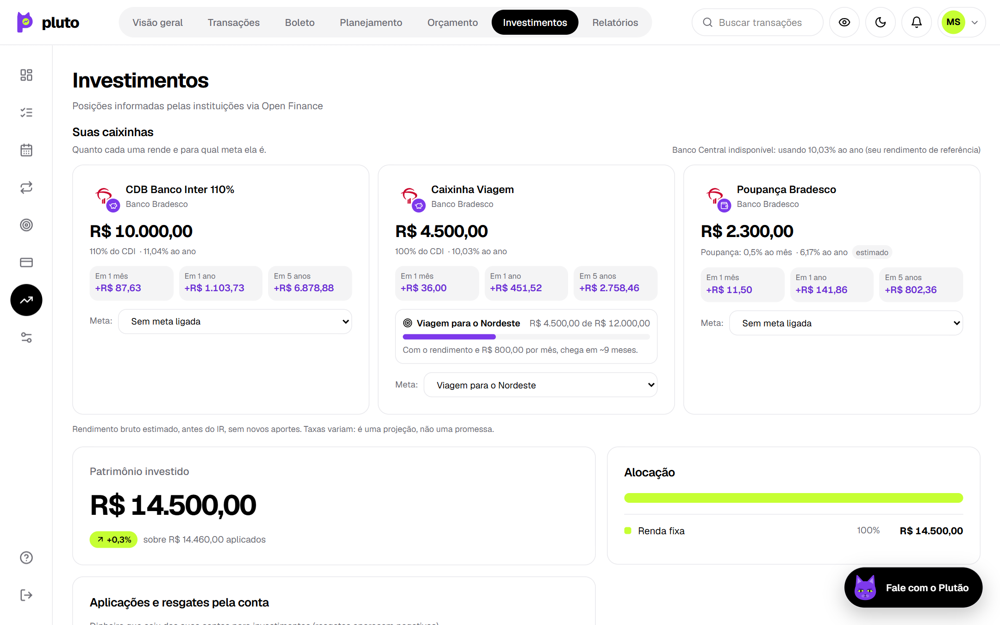<br><sub><b>Investimentos</b> · caixinhas, rendimento e metas</sub></td>
    <td>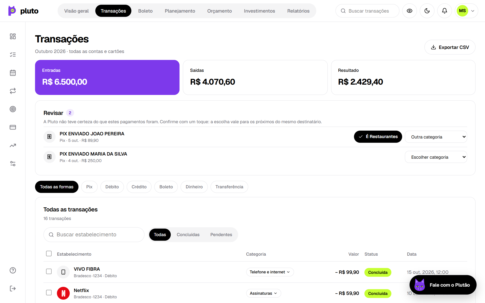<br><sub><b>Transações</b> · Revisar e filtro por forma de pagamento</sub></td>
  </tr>
  <tr>
    <td>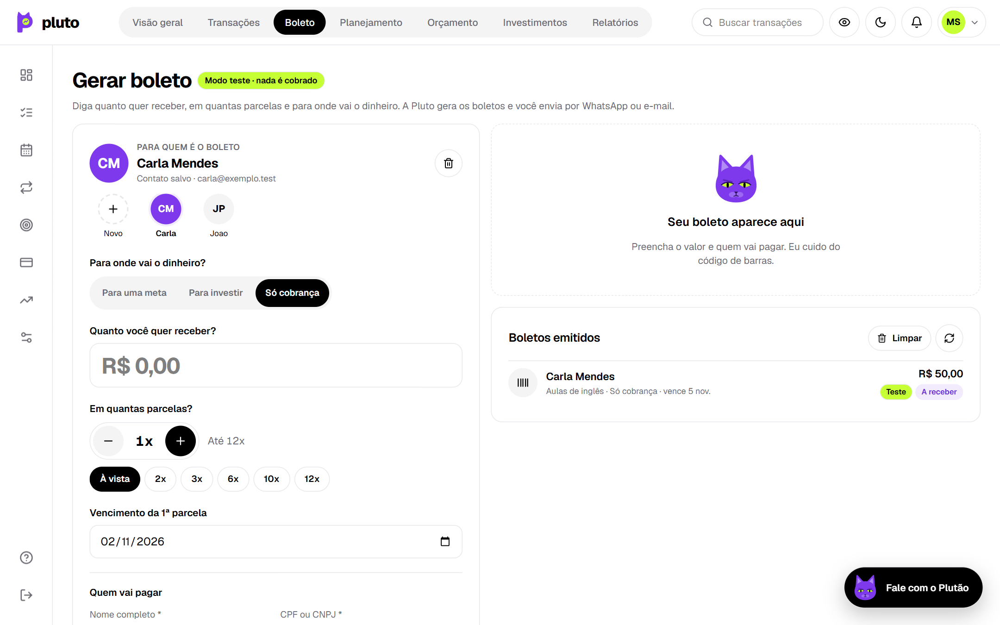<br><sub><b>Boleto</b> · contatos salvos e cobranças</sub></td>
    <td>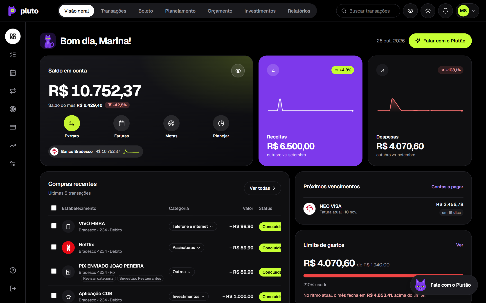<br><sub><b>Tema escuro</b></sub></td>
  </tr>
</table>

<p align="center">
  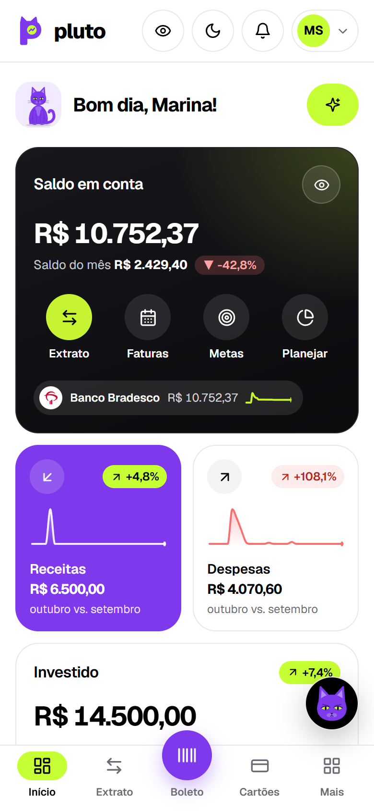
  &nbsp;
  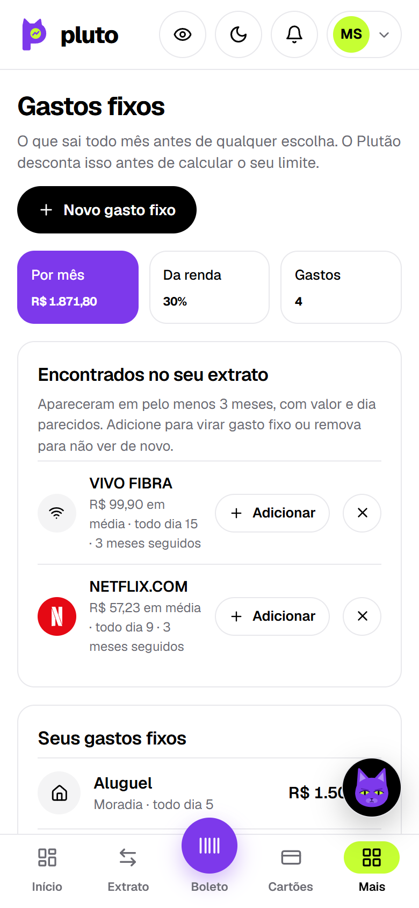
  &nbsp;
  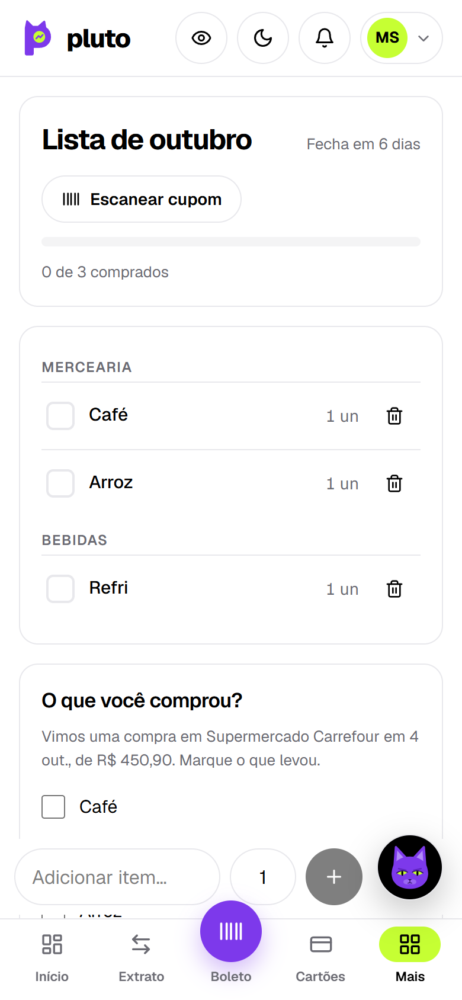
</p>

<p align="center"><sub>Capturas geradas com dados fictícios.</sub></p>

## Arquitetura

Um monorepo com a API, o site e dois pacotes compartilhados. Em produção, um único serviço roda os dois: o site atende o público e repassa `/v1` para a API, que só escuta na própria máquina.

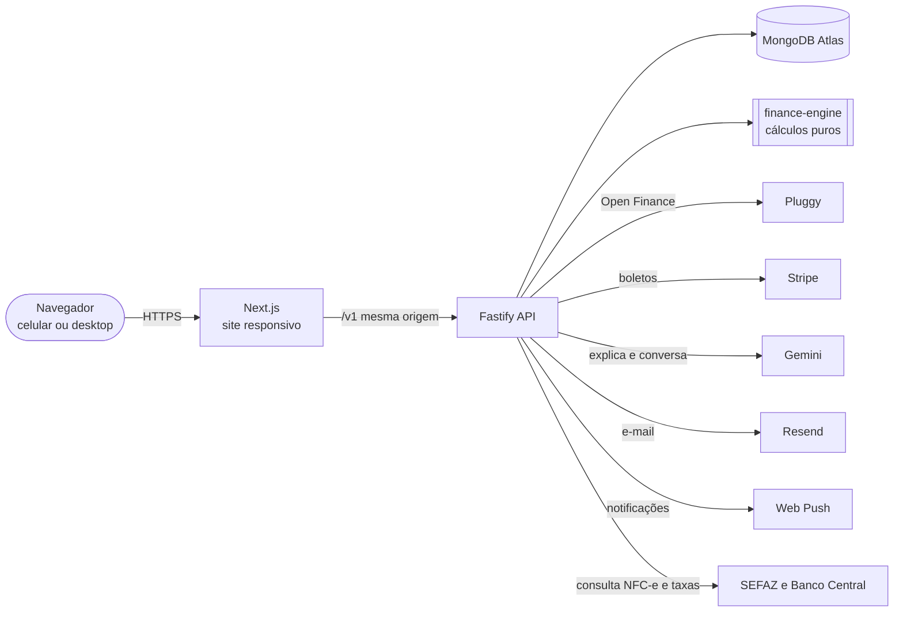

```text
apps/
  api/              Fastify + TypeScript: módulos (auth, sync, agent, planning, charges...) e jobs agendados
  web/              Next.js (App Router), responsivo
packages/
  shared/           schemas Zod e tipos compartilhados entre API e site
  finance-engine/   funções financeiras puras e testadas (projeção, juros, orçamento, recorrência...)
infra/              docker-compose do MongoDB local
.github/workflows/  CI (lint, tipos, testes, auditoria) e backup diário cifrado
```

**Princípios do projeto**
- **Números vêm do motor, não da IA.** O Gemini redige e conversa; os valores vêm do `finance-engine` e das ferramentas do agente, e um filtro confere cada R$ da resposta.
- **Dado do usuário é do usuário.** Campos sensíveis são criptografados, o usuário pode exportar e excluir tudo (LGPD) e a IA só recebe dados com consentimento.
- **Nada some em silêncio.** Escritas múltiplas em transação, migrações idempotentes e backup diário com teste de restauração.

## Stack

| Camada | Tecnologia |
| --- | --- |
| Site | Next.js 16 (App Router), React 19, Tailwind CSS 4, TanStack Query |
| API | Fastify 5, Zod 4 (validação de entrada e saída), TypeScript strict |
| Banco | MongoDB 7 (Atlas), validadores de schema e índices versionados |
| Integrações | Pluggy (Open Finance), Stripe (boleto), Gemini (IA), Resend (e-mail), Web Push |
| Qualidade | Vitest, ESLint, GitHub Actions, Dependabot, Sentry (opcional) |
| Deploy | Render (site e API num serviço) e MongoDB Atlas |

## Segurança e privacidade

- **Login:** senha com Argon2id, 2FA obrigatório (TOTP com códigos de recuperação) e passkeys. O token de acesso dura 15 minutos e o refresh token é rotacionado a cada uso; reutilizar um token antigo revoga a sessão inteira.
- **API:** CORS só para origens conhecidas, Helmet e CSP, limite de tentativas (login: 5 a cada 15 minutos) e campos extras recusados em toda rota.
- **Dados:** renda, CPF, saldos de dívidas, boletos, contatos e os IDs das conexões do Pluggy são cifrados com AES-256-GCM. De quem recebeu um Pix fica só um hash, e de cartões, só os últimos dígitos.
- **IA:** só com consentimento explícito; recebe agregados e nunca o extrato bruto. Pix para pessoa física nunca sai do servidor.
- **Operação:** backup diário cifrado com restauração conferida a cada execução e um [plano de recuperação](RECUPERACAO.md).

## Como rodar

**Requisitos:** Node.js 22+, pnpm 9 (`npm i -g pnpm@9`), MongoDB (Atlas ou `pnpm db:up` com Docker), conta no [Pluggy](https://pluggy.ai) e um app autenticador no celular.

```bash
pnpm install

# 1. Configuração da API
cp apps/api/.env.example apps/api/.env
node apps/api/scripts/gen-secrets.mjs        # gera as chaves; cole a saída no apps/api/.env
#    preencha MONGODB_URI, PLUGGY_CLIENT_ID e PLUGGY_CLIENT_SECRET
pnpm --filter @pluto/api db:setup            # coleções, validadores e índices

# 2. Seu usuário (senha + autenticador por QR Code + códigos de recuperação)
pnpm --filter @pluto/api user:create

# 3. Rodar
pnpm dev                                     # API em 127.0.0.1:3333 e site em http://localhost:3000
```

Depois de entrar, abra **Configurações › Importar do Meu Pluggy** e cole o Item ID da sua conexão. Use `http://localhost:3000` (e não `127.0.0.1:3000`), que é a origem liberada em `ALLOWED_ORIGINS`.

> As integrações opcionais (Gemini, Stripe, Resend, Web Push, Sentry) ficam desligadas sem a chave correspondente, e o app explica o que falta em cada tela. Fora de produção, use as chaves de **teste** do Stripe.

## Comandos

| Comando | O que faz |
| --- | --- |
| `pnpm dev` | API e site em modo desenvolvimento |
| `pnpm test` | Todos os testes (Vitest) |
| `pnpm test:coverage` | Testes com cobertura |
| `pnpm typecheck` | TypeScript strict em todos os pacotes |
| `pnpm lint` | ESLint |
| `pnpm build` | Build de todos os pacotes |
| `pnpm audit` | Auditoria das dependências de produção |
| `pnpm --filter @pluto/api db:setup` | Coleções, validadores e índices (idempotente) |
| `pnpm --filter @pluto/api pluggy:check <itemId>` | Confere uma conexão do Pluggy sem gravar nada |
| `pnpm --filter @pluto/api backup -- <pasta>` | Backup cifrado do banco |
| `pnpm --filter @pluto/api restore -- <arquivo>` | Restaura um backup num banco vazio |

## Qualidade

- **Mais de 400 testes** automatizados: motor financeiro, rotas da API com MongoDB em memória, agente Plutão (respostas da IA simuladas por roteiro), segurança, LGPD, migrações, backup e restauração.
- **CI** a cada push: lint, tipos, testes e `pnpm audit` (falha com vulnerabilidade alta). O **Dependabot** propõe atualizações toda semana.
- **Telas conferidas** de 390 a 1920 px de largura, sem rolagem horizontal, e valores que nunca são cortados.

## Deploy e operação

- [DEPLOY-RENDER.md](DEPLOY-RENDER.md): como publicar no Render com o MongoDB Atlas, as variáveis de ambiente e os erros comuns.
- [RECUPERACAO.md](RECUPERACAO.md): monitoramento, voltar a versão anterior, restaurar o backup, trocar chaves vazadas e avisar os usuários.
